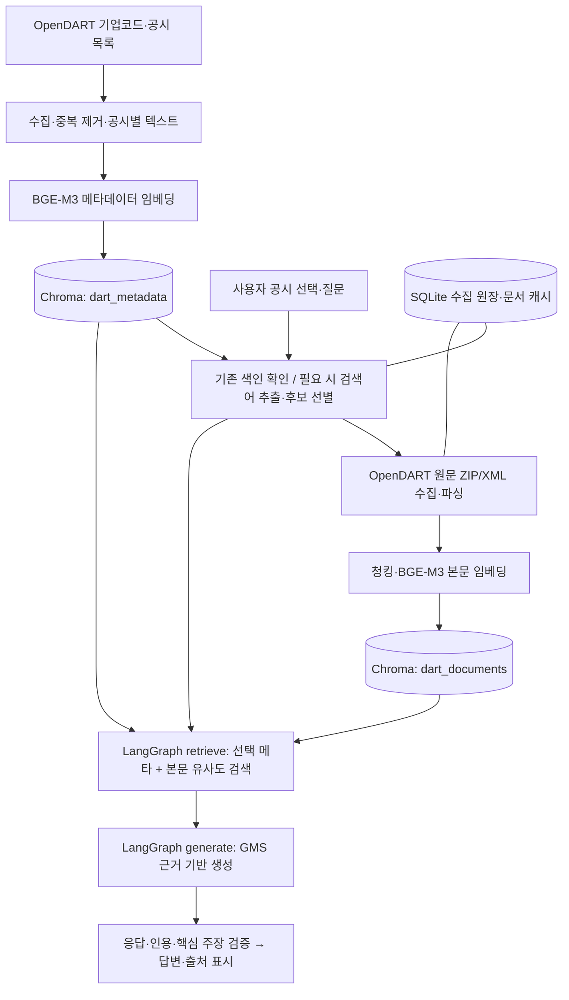

# DART Insight

삼성전자·현대자동차·금양의 **개별 공시를 선택해 원문 근거로 질문하고 핵심 내용을 분석하는 RAG 서비스**입니다. 긴 공시에서 필요한 사실·위험 요인·조건을 찾고, 답변에 연결된 인용과 공식 원문을 함께 확인하는 것을 목표로 합니다.

**제출 기준:** `submission/final`, 기능 기준 커밋 `39f1a43`. 필수 **F2001~F2012**를 구현 범위로 삼았으며 심화 **F2013~F2016은 미선택**입니다. MMR은 이 제출 버전의 구현 기능에 포함하지 않습니다. 구현 여부와 실제 운영 검증 범위는 아래 검증 기록에서 구분합니다.

> 공시 근거 기반 정보 제공 서비스이며 투자 권유가 아닙니다. 답변은 금융·투자 전문가의 조언을 대신하지 않습니다.

## 주요 기능

| 요구사항 | 제공 기능 | 주요 구현 위치 |
|---|---|---|
| F2001 | 공식 기업코드로 세 기업을 식별하고 유형별 공시 목록을 전체 페이지 조회·중복 제거·저장. 최소 100건 확보를 위한 기간 확대와 공시별 검색 텍스트 생성 | `collect.py`, `data/collection.py`, `opendart/client.py` |
| F2002 | 공시 메타데이터를 로컬 BGE-M3로 임베딩하고 Chroma에 저장·검색. 같은 ID의 변경 없는 문서는 재임베딩 생략 | `index_metadata.py`, `vectorstore/metadata.py`, `vectorstore/embeddings.py` |
| F2003 | 도메인 전문가 프롬프트로 질문의 검색어 추출·JSON 검증. 선택 공시 접수번호를 검색 대상에 포함 | `rag/query_extraction.py`, `rag/prompts/query_extraction.py` |
| F2004 | 외부 공시 목록·기존 벡터 후보 검색 → 별도 LLM 후보 선별 → 원문 수집. 선택 공시 원문 우선 포함, 원장으로 재수집 방지 | `services/rag_service.py`, `services/original_documents.py`, `data/collection_ledger.py` |
| F2005 | OpenDART ZIP/XML 원문 파싱·청킹·임베딩 후 별도 본문 컬렉션 저장. 청크 크기/중복 설정 및 공시별 충돌 방지 ID | `vectorstore/documents.py` |
| F2006 | 선택 공시 메타데이터를 고정 근거로 포함하고, 해당 공시 범위의 본문을 질문 유사도로 검색·병합·중복 제거. Top-k 설정 | `rag/retrieval.py` |
| F2007 | LangGraph `retrieve → generate`로 검색과 생성을 연결. 제공된 문서만 사용하도록 프롬프트·응답 검증 적용 | `rag/pipeline.py`, `rag/prompts/answer.py` |
| F2008 | 실제 인용한 근거의 번호·제목·원문 URL·내용 표시, 잘못된 인용 번호 거절 및 무인용 안내 | `rag/pipeline.py`, `ui/evidence.py`, `app.py` |
| F2009 | 기업·공시 선택, 공시별 채팅·세션 분석 기록, 공시 전환 후 기존 대화 재사용 | `ui/chat.py`, `rag/conversation.py`, `app.py` |
| F2010 | 공시 핵심 내용·날짜·금액·조건·위험 요인을 근거와 함께 분석. 상세 진입 시 원문 준비부터 자동 실행 | `services/runtime.py`, `rag/prompts/answer.py`, `app.py` |
| F2011 | 자연어 조건으로 저장 공시 후보를 검색·선별하고 결과에서 해당 공시 분석으로 이동 | `services/discovery.py`, `ui/search.py` |
| F2012 | 수집·색인·검색·생성 진행 상태, 미실행/실패/빈 결과 구분, 안전한 오류·진단 번호·면책 표시 | `ui/analysis_diagnostics.py`, `app.py`, `config.py` |

표의 상대 경로는 `dart_insight/` 기준이며 루트의 `app.py`는 예외입니다. 공식 요구사항 대조는 [최종 UX·품질 보고서](docs/ux-quality-final.md), [필수 요구사항 점검](docs/final-required-audit.md)을 참고하세요. 과거 보고서는 작성 시점의 상태를 담고 있으므로 기준 커밋과 최신 기록을 함께 확인합니다.

### 화면에서 사용하는 흐름

- **홈:** 최근 7일 공시와 압축형 기업 카드를 표시하고 최신 대표 공시 **1건/세션**만 자동 브리핑합니다. 카드 이동으로 다른 공시를 연쇄 분석하지 않습니다.
- **공시 탐색:** 기업·기간·유형·제목·자연어 조건으로 조회하고 개별 공시를 선택합니다.
- **공시 상세:** 저장된 원문 색인을 확인하고, 필요하면 수집·파싱·청킹·임베딩·색인 후 핵심 분석과 근거를 자동 표시합니다. 준비된 본문은 재수집·재색인하지 않습니다.
- **추가 질문·분석 기록:** 자동 분석 완료 후 질문할 수 있으며 같은 공시의 분석·대화 문맥을 이어갑니다. 완료 결과는 세션에서 재사용해 화면 갱신에 따른 중복 LLM 호출을 막습니다.
- 홈 실패 원인과 진단 번호는 화면 갱신 후에도 유지됩니다. 홈의 일시적 통신·서버·호출 한도 오류에는 명시적 재시도 1회만 제공하며, 원문 부재·파싱·인증·근거 검증 실패는 성공으로 대체하지 않습니다.

## 기술 스택과 아키텍처

| 영역 | 기술 |
|---|---|
| 언어·환경 | Python, `.python-version`의 기준 버전 **3.12**, 가상환경·python-dotenv |
| 사용자 화면 | Streamlit 1.62.0 |
| 수집·파싱 | requests, OpenDART API, ZIP/XML 처리, defusedxml |
| 임베딩 | sentence-transformers 5.1.2, transformers 4.57.3, CPU PyTorch 2.9.0, `BAAI/bge-m3` |
| 저장·검색 | ChromaDB 1.5.9, SQLite 수집 원장, JSON 메타데이터/응답 캐시 |
| RAG·생성 | LangChain 1.3.14, LangGraph 1.2.10, GMS Chat Completions(`gpt-4.1-mini` 기본값) |
| 테스트 | unittest, Streamlit AppTest, 임시 Chroma/SQLite·모의 외부 경계 |

LangSmith·OpenAI SDK 등 명세 지정 패키지도 [requirements.txt](requirements.txt)에 포함됩니다. 패키지 설치가 외부 추적 서비스 연동이나 배포 완료를 뜻하지는 않습니다.



기존 원문 색인이 완전하면 원문 준비 경로를 건너뛰고 검색·생성으로 진행합니다. 최초 준비에서는 GMS가 검색어 추출·후보 선별에도 사용됩니다. 임베딩은 **로컬 BGE-M3**이며 GMS 임베딩 API를 사용하지 않습니다. BGE 벡터는 dense **1024차원·정규화**로 저장/질문 검색에 같은 어댑터를 사용합니다.

### 두 컬렉션의 역할

| 컬렉션 | 저장 단위와 식별자 | 역할 |
|---|---|---|
| `dart_metadata` | 공시 1건당 메타데이터 텍스트, `meta:{rcept_no}` | 기업/공시 탐색·후보 검색·선택 공시 고정 근거. 제목·날짜·기업·접수번호·원문 URL 포함 |
| `dart_documents` | 수집한 실제 공시 본문의 청크. ID에 선택 공시·원문 접수번호·본문/청킹 설정 해시·순번 포함 | 질문 관련 본문 검색과 인용. 동일 원문이 여러 선택 공시에 연결되어도 덮어쓰지 않음 |

메타데이터만으로 본문 금액·위험 요인을 추정하지 않습니다. 기본 `TOP_K=5`는 선택 메타데이터 1건과 본문 최대 4건을 뜻하며, 실제 확보된 근거가 적으면 더 적게 반환합니다. 일반 질문은 선택 공시에 연결된 문서, 자동 핵심 분석은 선택 원문 범위로 검색합니다.

## 디렉터리 구조

```text
.
├── app.py                       # Streamlit 진입점
├── dart_insight/
│   ├── config.py                # 환경설정·키 비노출·면책
│   ├── collect.py               # 메타데이터 수집 CLI
│   ├── index_metadata.py        # 메타데이터 색인 CLI
│   ├── search_metadata.py       # 메타데이터 유사도 검색 CLI
│   ├── ask.py                   # 실제 RAG 질의 CLI
│   ├── export_documents.py      # 실제 원문 묶음 내보내기
│   ├── opendart/                # 공식 API 클라이언트
│   ├── data/                    # 모델·수집·캐시·SQLite 원장
│   ├── vectorstore/             # BGE-M3·메타/본문 색인
│   ├── services/                # 원문 준비·RAG·조건 검색 서비스
│   ├── rag/                     # 프롬프트·검색·LangGraph·응답 검증
│   └── ui/                      # 탐색·대화·근거·진단·레이아웃
├── scripts/
│   ├── verify_ux05_live.py      # 실제 통합 검증·최초/반복 분석 시간
│   └── benchmark_rag.py         # 합성 데이터/모의 모델 비교용, 실제 성능 아님
├── tests/                       # 단위·통합·UI 회귀 테스트 및 fixture
├── docs/                        # 요구사항·설계·검증·출처 문서
├── .streamlit/                  # 화면 설정·비밀값 없는 설정 예제
├── .env.example
├── requirements.txt             # 직접 의존성 버전 고정, Windows 설치용
└── requirements.lock.txt        # Linux/Python 3.12 검증 환경 잠금
```

기본 로컬 데이터는 Git에서 제외된 `.local/data/`에 둡니다. `metadata/run-*/collection.json`은 수집 결과, `chroma_bge_m3/`는 기존 벡터 DB, `collection.sqlite3`는 수집/색인 재개 원장, `cache/`는 API 캐시, `models/`는 기본 모델 캐시입니다. 키·운영 DB·모델 가중치는 저장소 clone에 포함되지 않습니다.

## 설치 및 환경변수 설정 — Windows Git Bash

아래 명령은 **프로젝트 루트의 Git Bash** 기준입니다. 새 환경은 Python 3.12를 설치하고 시작합니다. 이미 정상 동작하는 `.venv`, `.env`, DB와 모델 캐시가 있다면 생성·설치를 반복하지 말고 실행 단계로 이동하세요. 기존 Python 3.11 환경을 3.12로 교체하는 작업은 필수가 아닙니다. 이 저장소의 클라우드 회귀 검증 환경은 Linux/Python 3.12입니다.

```bash
# 새 가상환경이 필요한 경우에만 실행
py -3.12 -m venv .venv
./.venv/Scripts/python.exe -m pip install -r requirements.txt
./.venv/Scripts/python.exe -m pip check

# 기존 .env는 덮어쓰지 않음
[ -f .env ] || cp .env.example .env
```

`requirements.lock.txt`에는 `uvloop` 등 Linux용 항목이 있으므로 Windows에는 `requirements.txt`를 사용합니다. 기존 패키지·DB를 임의 업그레이드하거나 초기화하지 않습니다.

`.env`를 로컬 편집기로 열어 설정합니다. **실제 API 키를 README·코드·Git·채팅·로그에 기록하지 않습니다.**

| 변수 | 설정·용도 |
|---|---|
| `DART_API_KEY` | OpenDART에서 발급받은 키. 공시 목록·원문 조회 |
| `GMS_API_KEY` | GMS 생성용 키. 기존 `OPENAI_API_KEY` 별칭도 지원하며 둘 다 있으면 `GMS_API_KEY` 우선 |
| `OPENAI_CHAT_MODEL` | 기본 `gpt-4.1-mini` |
| `DART_DATA_DIR` | 기본 `.local/data` |
| `CHROMA_DB_DIR` | 기존 DB를 재사용하려면 `.local/data/chroma_bge_m3` 등 **실제 기존 경로** |
| `EMBEDDING_MODEL` / `EMBEDDING_DEVICE` | `BAAI/bge-m3` / 기본 `cpu` |
| `EMBEDDING_CACHE_DIR` | 선택 사항. 비어 있으면 `DART_DATA_DIR/models`; 기존 모델 캐시가 다른 위치면 해당 경로 |
| `CHUNK_SIZE` / `CHUNK_OVERLAP` | 기본 `1000` / `200` |
| `TOP_K` / `CANDIDATE_TOP_K` | 기본 `5` / `5` |
| `DOCUMENT_SEARCH_DAYS` | 기본 `366`, 선택 공시 이전 외부 후보 조회 범위 |
| `DART_TIMEOUT_SECONDS` / `DART_REQUEST_INTERVAL_SECONDS` | 기본 `20` / `0.3`초 |
| `EMBEDDING_BATCH_SIZE` / `GMS_MAX_OUTPUT_TOKENS` | 기본 `4` / `4096` |
| `DOCUMENT_BUNDLE` | 선택 사항. 실제 OpenDART 원문 묶음 JSON을 이용하는 대체 수집 모드 |

기본값과 전체 변수는 [.env.example](.env.example)을 확인하세요. 설정 우선순위는 **환경변수 > 앱에 전달된 Streamlit Secrets > `.env` > 기본값**입니다. CLI는 Streamlit Secrets 파일을 직접 읽지 않습니다. GMS 요청은 `gms.ssafy.io` 게이트웨이를 사용합니다.

BGE-M3 최초 사용에는 Hugging Face 가중치 다운로드와 메모리·디스크 공간이 필요합니다. 완전한 모델 캐시가 있을 때만 `HF_HUB_OFFLINE=1`, `TRANSFORMERS_OFFLINE=1`로 오프라인 로딩할 수 있습니다. 모델 캐시만으로 OpenDART/GMS까지 오프라인 실행되는 것은 아닙니다.

## Streamlit 실행과 기존 색인 재사용

```bash
./.venv/Scripts/python.exe -m streamlit run app.py
```

터미널에 표시된 주소를 브라우저에서 엽니다. `.env`의 `CHROMA_DB_DIR`이 기존 `.local/data/chroma_bge_m3`를 가리키면 그 색인을 재사용합니다. 앱을 켜기 위해 메타데이터 전체를 다시 수집·색인할 필요는 없습니다. 기존 `.local/data/collection.sqlite3`와 모델 캐시도 함께 보존하세요.

홈 대표 브리핑·상세 진입은 실제 원문 조회와 GMS 호출을 시작할 수 있습니다. 미색인 공시는 선택 메타데이터 1건과 필요한 본문만 증분 준비합니다. 본문 불러오기·색인·AI 분석 버튼을 순서대로 누를 필요는 없습니다. 원문 부재·파싱 실패 시 불완전한 본문으로 분석하지 않습니다. 검증 가능한 원장 기록이 없거나 기존 청킹/모델 설정이 다르면 자료를 보존하고 안전하게 중단하므로 DB 삭제로 우회하지 마세요.

### 데이터가 없는 환경의 최초 수집·색인

실제 DART 키와 네트워크 연결이 필요합니다. 아래 기간은 **재현용 입력 예시**이며 기존 1,065건의 실제 수집 기간이라고 주장하지 않습니다.

```bash
./.venv/Scripts/python.exe -m dart_insight.collect --begin 2025-01-01 --end 2025-12-31

# 위 명령이 출력한 output_path의 실제 collection.json 경로 입력
read -r -p '수집 결과 collection.json 경로: ' collection_file
./.venv/Scripts/python.exe -m dart_insight.index_metadata --input "$collection_file" --dry-run
./.venv/Scripts/python.exe -m dart_insight.index_metadata --input "$collection_file" --db-dir .local/data/chroma_bge_m3 --batch-size 16
```

수집기는 기본 A~J 전체 유형·페이지를 조회하고 부족하면 기간을 확대합니다. `summary.status=complete`, 고유 공시 100건 이상·세 기업 자료를 검증한 JSON만 색인합니다. 신규 실행 폴더를 쓰므로 과거 `run-*` 경로를 고정하지 않습니다.

**경로 주의:** 현재 `index_metadata`·`search_metadata` CLI의 인자 생략 시 기본 DB는 `DART_DATA_DIR/chroma`입니다. 앱이 사용하는 `.local/data/chroma_bge_m3`와 일치시키려면 위와 같이 `--db-dir`을 명시하세요.

동일 입력의 재실행은 아래 명령으로 확인할 수 있습니다. 입력·모델이 같고 이전 색인이 완전하면 `count_delta=0`, `embedded_count=0`이 기대되며 실제 출력으로 확인합니다. 기존 정상 DB 재사용에는 이 재색인 확인 명령도 필수는 아닙니다.

```bash
./.venv/Scripts/python.exe -m dart_insight.index_metadata --input "$collection_file" --db-dir .local/data/chroma_bge_m3 --batch-size 16
./.venv/Scripts/python.exe -m dart_insight.search_metadata --db-dir .local/data/chroma_bge_m3 --query '사업 위험' --top-k 5
```

첫 CLI는 색인을 수행하고 두 번째는 기존 메타데이터 검색입니다. 실제 RAG 질의는 기존 DB에 있는 접수번호로 실행합니다.

```bash
read -r -p '색인된 14자리 공시 접수번호: ' receipt
./.venv/Scripts/python.exe -m dart_insight.ask --receipt "$receipt" --question '이 공시에 명시된 위험 요인은 무엇인가요?'
```

외부 원문 접근이 제한되면 실제 원문을 내보낸 `DOCUMENT_BUNDLE`을 사용할 수 있습니다. 가짜 본문을 생성하는 기능이 아니며 선택 공시 원문이 반드시 있어야 합니다. 사용 절차·형식은 [통합 설계](docs/required-integration.md)를 참고하세요.

## 자동화 테스트

Windows Git Bash:

```bash
./.venv/Scripts/python.exe -m unittest discover -s tests -v
./.venv/Scripts/python.exe -m unittest discover -s tests -p test_home_briefing.py -v
./.venv/Scripts/python.exe -m unittest discover -s tests -p test_verify_ux05_live.py -v
```

Linux/Python 3.12의 별도 개발 환경:

```bash
python3.12 -m venv .venv
.venv/bin/python -m pip install -r requirements.lock.txt
.venv/bin/python -m pip check
.venv/bin/python -m unittest discover -s tests -v
```

기준 커밋의 기록은 **309개 실행: 308개 통과, 실패 0, 오류 0, Windows 전용 1개 skip**, 72.981초입니다([진행 현황](docs/progress.md), [품질 보고서](docs/ux-quality-final.md)). Linux에서 Windows 파일 삭제 잠금 전용 테스트를 실행한 것으로 간주하지 않습니다. 외부 HTTP/GMS/BGE 인코더는 주로 모의 경계이고, 실제 임시 Chroma/SQLite·ZIP 파서·LangGraph·UI를 통과하는 통합 테스트가 포함됩니다. 이 결과가 실제 API 정확성·부하 성능 검증을 대신하지는 않습니다. 이번 README 문서 작업에서는 전체 테스트를 다시 실행하지 않았습니다.

## 실제 통합 검증과 성능 기록

**저장소 기록·검증 코드·사용자 로컬 보고를 구분합니다.** 운영 DB와 원본 로컬 JSON 보고서는 이 저장소에 포함되어 있지 않습니다.

| 항목 | 기록된 결과 | 확인 근거·범위 |
|---|---|---|
| 공시 메타데이터 최초 수집 | **1,065건**: 삼성전자 827 / 현대자동차 172 / 금양 66, `summary.status=complete` | [수집 기록](docs/progress.md#f2001-사용자-로컬-실제-검증), [검증 기록](docs/validation.md). 사용자 로컬 결과이며 원본 JSON을 클라우드에서 재집계하지 않음 |
| 기존 메타데이터 색인 | 로컬 1,065건 색인·재사용 보고 | 기존 README·운영 확인 보고에 근거. 실제 운영 컬렉션/재색인 출력은 저장소에 없어 직접 재검증하지 않음 |
| OpenDART/BGE-M3/GMS 실제 연결 | 사용자 Windows 실검증에서 미색인·기존 색인 두 항목 PASS 보고. 미색인 원문 청크 2 / 인용 2 / 수집 1회 / 색인 1회, 기존 색인은 재수집·재색인 없음 | [Windows 정리 오류 및 실검증 기록](docs/ux-quality-final.md). 초기 실행은 두 PASS 뒤 `PermissionError`로 최종 failed였고, 자식 프로세스 종료 후 정리하도록 수정됨. 두 항목 PASS와 전체 정상 종료 PASS는 구분 |
| 최초 / 반복 분석 시간 | 사용자 제공값 **29.890초 / 15.516초** | `verify_ux05_live.py`의 최초·반복 `Runtime.ask()` 측정 필드와 대응. **원본 시간 보고서 미포함으로 수치 독립 대조는 미완료** |
| 홈 자동 AI 브리핑 | 사용자 로컬 동작 확인 보고 | 이 README 작성 요청에서 제공된 확인 내용. 성공 화면/접수번호/원본 로그는 미포함. 저장소에는 성공·실패·중복 호출 방지 회귀 테스트가 있음 |

위 로컬 보고를 클라우드에서 실제 API로 재현한 결과나 모든 공시의 성공 보장으로 해석하지 않습니다. 시간은 단일 공시 실행 사례이며 평균·백분위·동시 사용자 성능 수치가 아닙니다. 최초 측정은 Runtime 생성 후 `ask()`부터 시작하며 원문 준비·질문/본문 임베딩·답변 생성 등 해당 호출 경로를 포함합니다. 반복 측정은 같은 Runtime에서 기존 원문 색인을 재사용한 `ask()`입니다. 최초 `ask()`에서 BGE가 지연 로딩되면 그 시간도 포함합니다. 별도 목록 조회·Runtime 생성·웹 페이지 렌더링을 합친 전체 대기 시간은 아닙니다.

### 실제 검증 재실행 — Windows Git Bash

키·BGE 캐시가 준비된 환경에서 실행합니다. 이 스크립트는 운영 DB와 분리된 임시 DB에서 실제 수집·임베딩·GMS 분석을 수행하므로 비용·실행 시간이 발생할 수 있습니다.

```bash
./.venv/Scripts/python.exe scripts/verify_ux05_live.py --stock 005930 --output .local/data/live-timing-report.json
```

최근 7일 중 해당 기업의 실제 공시 1건을 선택합니다. 특정 공시를 지정하려면 같은 최근 7일 범위에 존재하는 `--receipt`를 추가합니다. 적합한 공시가 없거나 키가 없으면 `blocked`이며 성공 결과를 만들지 않습니다. 출력 경로의 기존 보고서를 보존하려면 새 파일명을 사용하세요.

JSON의 `runs`에 `initially_unindexed`·`already_indexed` 결과가 기록되고 `timings.first_analysis_seconds`, `timings.repeat_analysis_seconds`에 분석 시간이 남습니다. **두 검증·자식 정상 종료·임시 디렉터리 정리까지 모두 성공해야 최종 `status=passed`, 종료 코드 0**입니다. 개별 PASS만으로 전체 성공을 선언하지 않습니다. `scripts/benchmark_rag.py`는 합성 데이터·모의 모델용으로 위 실제 성능 수치의 근거로 사용하지 않습니다.

## 데이터 출처와 이용 조건

- 금융감독원 [OpenDART](https://opendart.fss.or.kr/): 공식 기업코드 `corpCode.xml`, 공시 목록 `list.json`, 원문 `document.xml` 사용.
- 사용자 근거 링크는 [DART 공시 뷰어](https://dart.fss.or.kr/)의 접수번호별 URL을 사용하며 인증키를 포함하지 않습니다.
- 공시·기업정보의 권리는 금융감독원/공시 제출인 등 원 권리자에게 있습니다. API 접근 가능 여부가 무제한 재배포 허가를 뜻하지 않습니다.
- GET·TLS 검증·호출 간격·제한 재시도·캐시를 사용합니다. 최신 호출 한도·인증키 이용 조건·출처 표시·재배포 조건은 [공식 가이드](https://opendart.fss.or.kr/guide/main.do)와 제공 정책을 확인해야 합니다. 최신 약관 검토 완료나 공개 재배포 권한 확보를 주장하지 않습니다.
- 실제 키·운영 DB·원문 진단 ZIP·민감 응답은 공개 제출물에 무단 포함하지 않습니다. 상세 출처·확인 상태는 [출처와 이용 조건](docs/sources.md)을 참고하세요.

## 구현 범위와 제한사항

- **필수 F2001~F2012 대상, 심화 F2013~F2016 미선택.** 별도 프론트엔드, MMR, RAG 전후 비교 실험, 다종 원문 출처 결합을 완료 기능으로 제출하지 않습니다.
- 대상 기업은 삼성전자(`005930`)·현대자동차(`005380`)·금양(`001570`)입니다. 공시 식별·대화 분리 단위는 기업명이 아닌 `rcept_no`입니다.
- OpenDART는 자유 텍스트 웹 검색 API가 아닙니다. 후보 검색은 대상 기업 공시 목록·메타데이터 벡터와 설정된 기간으로 제한됩니다. 자연어 탐색에서 메타데이터에 없는 본문 조건을 확인했다고 단정하지 않습니다.
- 실제 원문이 없는 공시·지원하지 않는 형식·손상된 ZIP/XML·검증 불가한 레거시 색인은 안전 실패할 수 있습니다. 성공을 위해 본문을 임의 생성하거나 DB를 초기화하지 않습니다.
- 자동 분석의 원문 준비·생성 시간은 공시 길이·모델 캐시·CPU·네트워크·GMS 상태에 따라 달라집니다. 모든 요청의 응답 시간 보장·동시 부하 검증·배포 완료 기록은 없습니다.
- 대화·분석 기록은 **현재 Streamlit 세션 범위**이며 새로고침·세션 종료·서버 재시작 후 영구 복원을 제공하지 않습니다. 수집 원장은 대화 영구 저장소가 아닙니다.
- 하나의 운영 DB에서 여러 수집/색인 작업자의 동시 실행을 위한 분산 잠금은 제공하지 않습니다. DB·원장·캐시를 보존하고 실행 환경/벡터 프로필을 일치시키세요.
- 차트는 단위와 비교 행·열을 확인할 수 있는 원문 표에 한해 표시합니다. 모든 공시를 수치 차트로 변환하는 기능은 아닙니다.
- 배포 설정·운영 접근 권한·최신 이용 조건·실제 답변 품질·공식 셀프/상호 체크리스트 및 최종 제출 증빙은 별도 확인 대상입니다.

추가 자료: [구조 설계](docs/architecture.md) · [공식 명세 분석](docs/requirements-analysis.md) · [실제 검증 체크리스트](docs/required-integration.md#제출용-실행-체크리스트) · [관리자 진단 접근](docs/admin-access.md) · [최근 진행 기록](docs/progress.md)
